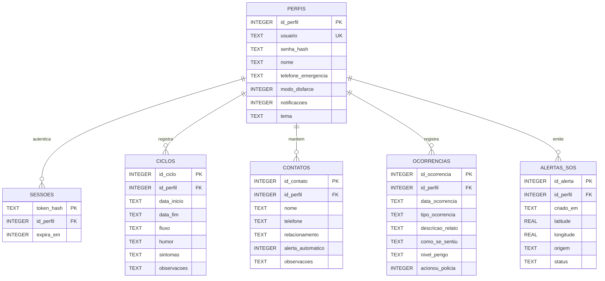

# DER — Meu Ciclo+ (SQLite, schema v2)

Fonte de verdade: `backend/src/schema.sql` (v1) e `backend/src/migration-2.sql` (v2), conferidos na branch `master` no commit `e0fa3da2e22fb9e758a9362008693cc2e7aea939`.

## Relacionamentos e integridade

- `PERFIS` é a entidade principal. Cada tabela filha tem `id_perfil` como chave estrangeira para `perfis(id_perfil)`, com `ON DELETE CASCADE`.
- As sessões armazenam o hash do token, não o token em texto simples. `usuario` é único.
- Os campos booleanos são inteiros `0` ou `1`, validados por `CHECK`.
- Ciclos validam que `data_fim >= data_inicio` e que o fluxo é Leve, Moderado ou Intenso.
- SOS registra coordenadas dentro de intervalos válidos, origem `simulada` ou `dispositivo_teste`, e status Novo, Em atendimento ou Concluído.
- Os índices por `id_perfil` facilitam a consulta dos registros vinculados à conta.
- Os schemas utilizam tabelas SQLite `STRICT`.

## Migrações

A versão 1 cria perfis, sessões, ciclos, contatos e ocorrências. A migração 2 acrescenta `alertas_sos`, seu índice, e define `PRAGMA user_version = 2`. O módulo `backend/src/database.js` aplica as mudanças em transações. A integridade e a migração precisam continuar verificadas por testes ao alterar o esquema.

## Limitações

Este DER é uma descrição da implementação acadêmica atual, não um modelo MySQL nem uma declaração de adequação do banco a dados sensíveis reais. O aplicativo deve ser testado apenas com dados fictícios.
